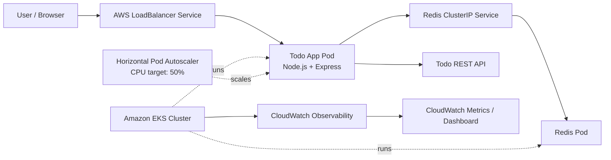

::: {align="center"}
# ✨ Todo App --- Cloud Native Deployment

**A clean, containerized task manager deployed on Amazon EKS with Redis,
Kubernetes autoscaling, and CloudWatch monitoring.**

[](https://nodejs.org/)
[](https://www.docker.com/)
[](https://kubernetes.io/)
[](https://redis.io/)
[](https://aws.amazon.com/)
:::

------------------------------------------------------------------------

## 📌 Overview

This repository contains a **Todo task management application** packaged
with Docker and deployed to **Amazon Elastic Kubernetes Service (EKS)**.
The application uses a Node.js/Express server for the web interface and
API, with Redis as the task-data backend.

The deployment demonstrates core cloud-native concepts:
containerization, image publishing, Kubernetes Deployments and Services,
health probes, Horizontal Pod Autoscaling (HPA), and cloud monitoring.

> **Lab context:** This project was built for a cloud computing
> assignment. AWS services are used as the cloud-platform equivalents of
> the Azure services mentioned in the original brief.

## 🖥️ Application Preview

The interface includes a task summary, task creation with priority
selection, search, status filters, completion toggles, and task removal.

```{=html}
<!-- Add your application screenshot to the repository, for example: docs/todo-app-preview.png -->
```
```{=html}
<p align="center">
```
`<em>`{=html}Add your application screenshot here:
`<code>`{=html}docs/todo-app-preview.png`</code>`{=html}`</em>`{=html}
```{=html}
</p>
```
## 🏗️ Architecture



### Request flow

1.  A user opens the application through the AWS LoadBalancer service.
2.  The Todo application serves the frontend and API through
    Node.js/Express.
3.  Task data is stored in Redis through the Kubernetes service named
    `redis`.
4.  Kubernetes health probes check the application's health endpoint.
5.  The HPA monitors pod CPU utilization relative to its CPU request and
    can scale the Todo deployment from **1 to 5 replicas** when needed.
6.  CloudWatch provides infrastructure and cluster observability.

## 🧰 Tech Stack

  Component                  Technology
  -------------------------- -----------------------------------------
  Frontend                   HTML, CSS, JavaScript
  Application server / API   Node.js, Express
  Task data store            Redis
  Containerization           Docker
  Container registry         Amazon Elastic Container Registry (ECR)
  Kubernetes                 Amazon EKS
  Scaling                    Kubernetes Horizontal Pod Autoscaler
  Monitoring                 Amazon CloudWatch
  Local orchestration        Docker Compose

## 📁 Repository Structure

``` text
todo-app/
├── app.js
├── index.html
├── server.js
├── Dockerfile
├── docker-compose.yml
├── k8s/
│   ├── deployment.yaml
│   ├── service.yaml
│   └── hpa.yaml
├── docs/
│   └── todo-app-preview.png
├── load-test.ps1
├── .gitignore
└── README.md
```

*Keep the file names and paths in this diagram aligned with the files
actually committed to the repository. Remove any entries you have not
created.*

## 🚀 Run Locally

### Prerequisites

-   [Docker Desktop](https://www.docker.com/products/docker-desktop/)
-   Git
-   Node.js is only needed if you want to run the server outside Docker.

### Start with Docker Compose

From the project root:

``` bash
docker compose up --build
```

Open the application at:

``` text
http://localhost:3000
```

Stop the local services with:

``` bash
docker compose down
```

Docker Compose should configure the app and Redis on a shared bridge
network. Ensure the app's Redis URL points to the Compose service name
(for example, `redis://redis:6379`) when running inside Compose.

## ☁️ AWS Deployment

The deployment was created in the AWS **Sydney region**
(`ap-southeast-2`).

### Resources used

-   **Amazon ECR:** stores the `todo-app` container image.
-   **Amazon EKS:** runs the Kubernetes cluster named `todo-lab`.
-   **Kubernetes Deployment:** manages the Todo and Redis pods.
-   **Kubernetes Services:** exposes the Todo app using a LoadBalancer
    and provides internal Redis access using ClusterIP.
-   **HPA:** targets 50% CPU utilization and permits 1--5 Todo replicas.
-   **CloudWatch:** provides metrics and dashboarding for the cluster
    and worker node.

### Deploy the Kubernetes manifests

After configuring `kubectl` for your own EKS cluster and confirming that
the image URI in the manifest points to your ECR repository:

``` bash
kubectl apply -f k8s/deployment.yaml
kubectl apply -f k8s/service.yaml
kubectl apply -f k8s/hpa.yaml
```

Check the rollout and current resources:

``` bash
kubectl get nodes
kubectl get deployments
kubectl get pods
kubectl get services
kubectl get hpa
```

Watch autoscaling activity:

``` bash
kubectl get hpa todo-app --watch
```

Retrieve the public service hostname:

``` bash
kubectl get service todo-app
```

If the external hostname is still pending, wait for the AWS load
balancer to finish provisioning.

> **Before deploying:** Update the image URI in `k8s/deployment.yaml` to
> your own ECR image. The Kubernetes manifests must reference the
> correct registry, region, account, and image tag.

## 📈 Autoscaling and Health Checks

The Todo Deployment is configured with an HPA targeting **50% CPU
utilization**, with a minimum of **1 replica** and a maximum of **5
replicas**.

The application Deployment should include:

-   CPU request and limit settings.
-   Memory request and limit settings.
-   A readiness probe to determine when a pod can receive traffic.
-   A liveness probe to detect a container that needs restarting.

The HPA calculates CPU utilization relative to the configured CPU
request. Removing the CPU request can prevent utilization-based scaling
from being calculated correctly.

## 📊 Monitoring

Amazon CloudWatch is used as the AWS observability equivalent for the
Azure Monitor requirement in the lab brief.

The configured CloudWatch dashboard includes: - Kubernetes API request
count. - EC2 worker-node CPU utilization.

The HPA output also provides pod CPU utilization and replica count
during scaling tests.

**Metric scope matters:** HPA CPU utilization is measured relative to
the container's CPU request. EC2 `CPUUtilization` represents CPU use for
the worker-node instance. These metrics are not directly
interchangeable.

Application-level HTTP request counts, P95 latency, and per-pod memory
charts require suitable instrumentation and metric collection; do not
assume they are present unless they have been configured and verified.

## 🧪 Load Testing

A short load test was used to increase request traffic to the Todo
application and observe HPA behavior.

Watch the HPA in one terminal:

``` powershell
kubectl get hpa todo-app -w
```

In another terminal, run your configured load-generation script, for
example:

``` powershell
.\load-test.ps1
```

Run the test for **no more than 3--5 minutes**, as required by the
assignment. Verify the script's URL and duration before running it.

During the test, record: - HPA CPU utilization before and during load. -
Replica count before and after scale-up. - Pod readiness and restart
counts. - CloudWatch metrics and alarm state. - Actual load-test
results.

In the recorded test, the HPA reached **79% CPU utilization against the
50% target**, and the Todo deployment scaled from **one replica to
two**. The supplied evidence did not establish a delivered alert email
or provide an application P95 latency graph.

## 🧹 Cleanup

AWS resources can incur charges while they exist. After saving the
screenshots and report, remove resources created for the lab when they
are no longer needed.

Review the resources first:

``` bash
aws eks list-nodegroups --cluster-name todo-lab --region ap-southeast-2
aws eks list-clusters --region ap-southeast-2
```

Delete the node group before deleting the cluster:

``` bash
aws eks delete-nodegroup \
  --cluster-name todo-lab \
  --nodegroup-name todo-workers \
  --region ap-southeast-2

aws eks wait nodegroup-deleted \
  --cluster-name todo-lab \
  --nodegroup-name todo-workers \
  --region ap-southeast-2

aws eks delete-cluster \
  --name todo-lab \
  --region ap-southeast-2
```

Also check and remove any remaining load balancers, CloudWatch
resources, ECR images/repository, and other lab-created resources that
you no longer need. Confirm each resource before deleting it; do not
remove resources used by other projects.

## 📚 Assignment Coverage

  -----------------------------------------------------------------------
  Requirement                         Project evidence
  ----------------------------------- -----------------------------------
  Docker image build                  Docker build completed successfully

  Local app and Redis containers      Shown running in Docker Desktop

  Image in container registry         `todo-app:1.0` pushed to Amazon ECR

  Kubernetes deployment               Todo and Redis pods running on EKS

  Service exposure                    Todo LoadBalancer and Redis
                                      ClusterIP

  HPA configuration                   Minimum 1, maximum 5 replicas; 50%
                                      CPU target

  Autoscaling under load              HPA showed 79% CPU and scaled from
                                      1 to 2 replicas

  Cloud monitoring                    CloudWatch dashboard with API
                                      request count and EC2 CPU

  Alert email                         Not confirmed by the supplied
                                      evidence

  P95 latency and per-pod memory      Not shown in the supplied dashboard
  graphs                              evidence
  -----------------------------------------------------------------------

## 👤 Author

**Aditya Singh**

Cloud Computing Lab Project --- Todo Application on AWS

------------------------------------------------------------------------

::: {align="center"}
**Built to practice containerization, Kubernetes orchestration,
autoscaling, and cloud monitoring.**
:::
